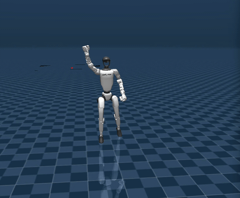
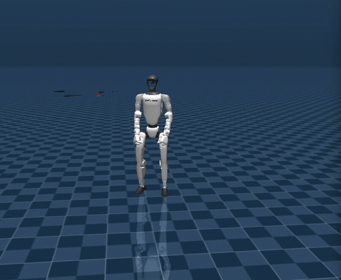
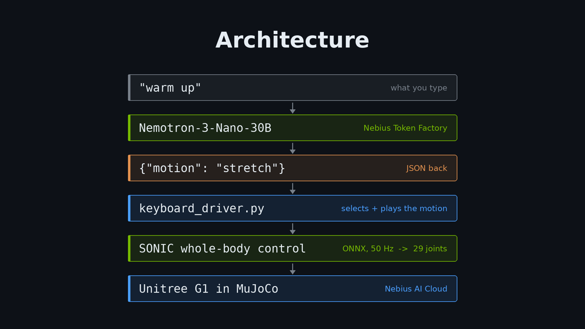
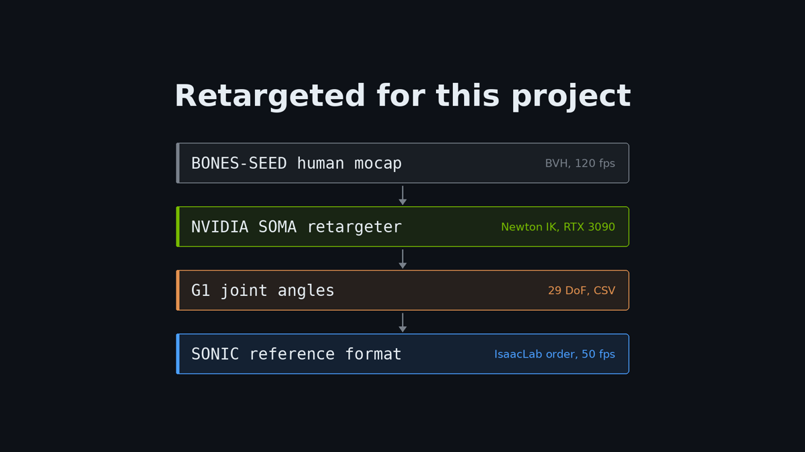

# G1 Humanoid at Your Command

Natural-language commands driving a Unitree G1 humanoid in simulation.

You type *"warm up"*. An NVIDIA Nemotron model served on Nebius Token Factory
resolves it to a motion. The motion is played through NVIDIA SONIC, which
executes it on a G1 in MuJoCo while handling whole-body balance — on a Nebius
AI Cloud GPU instance.

<table>
<tr>
<td width="50%"><br><em>you type <code>hello</code> → wave</em></td>
<td width="50%"><br><em>you type <code>warm up</code> → stretch</em></td>
</tr>
</table>



The router handles indirect phrasing and refuses commands it has no motion for:

| you type | routed to |
|---|---|
| `hello` | wave |
| `warm up` | stretch |
| `slide back` | moonwalk |
| `come to me` | walk |
| `make a pizza` | *no matching motion* |

Three of those share no vocabulary with the motion name.

## NVIDIA models and Nebius services used

| Component | Role | Runs on |
|---|---|---|
| **Nemotron-3-Nano-30B-A3B** | natural language → motion selection | Nebius Token Factory |
| **SONIC** (GEAR-SONIC) | whole-body controller, keeps G1 balanced | Nebius AI Cloud |
| **SOMA Retargeter** | human mocap → G1 joint trajectories | local RTX 3090 |
| **BONES-SEED** | source motion capture dataset | — |

Nemotron is reached through Token Factory's OpenAI-compatible endpoint
(`https://api.tokenfactory.nebius.com/v1/`). SONIC and MuJoCo run on a Nebius
AI Cloud VM (RTX PRO 6000, Ubuntu 24.04 + CUDA 13, TensorRT 10.13).

Token Factory is what kept the language layer out of the critical path: no
inference server to stand up, no GPU reserved for the LLM alongside the one
running SONIC, and the whole Nemotron family reachable through one endpoint.

## Layout

```
src/
  nemotron_router.py             command text -> motion name
  keyboard_driver.py             drives SONIC's keyboard interface under a pty
  convert_bones_to_reference.py  retargeted G1 CSV -> SONIC reference folder
  sonic_motion_publisher.py      ZMQ pose publisher
  zmq_session.py                 persistent ZMQ session
  command_layer.py               router + ZMQ publisher in one session
tools/
  seed_safe_motion_filter.py     shortlist stable motions from BONES-SEED metadata
  add_body_data.py               populate body kinematics via MuJoCo forward kinematics
  make_cmd_folders.py            SOMA order -> IsaacLab order, writes motions_cmd/
  replay_motion.py               kinematic replay in MuJoCo, no controller
models/g1/                       G1 MuJoCo model
assets/                          diagrams and clips used in this README
                                 (motion data is not redistributed — see below)
```

## Setup

```bash
uv sync                          # or: pip install pyzmq pandas numpy scipy openai mujoco huggingface-hub pyarrow
export NEBIUS_API_KEY=...        # tokenfactory.nebius.com
```

## Run

Test the router on its own — no GPU, no robot:

```bash
uv run python src/nemotron_router.py --selftest
uv run python src/nemotron_router.py "slide backwards like michael jackson"
```

Validate the motion data (needs the motion folders — see
[Getting the motion data](#getting-the-motion-data)):

```bash
uv run python src/sonic_motion_publisher.py --motion wave --dry-run
```

Drive the robot, on a machine with SONIC deployed. Copy the **contents** of
`motions_cmd/` into the deploy's `reference/cmd/` directory, then run from the
deploy root:

```bash
python src/keyboard_driver.py --motion-data reference/cmd/ --llm
```

Press `9` in the MuJoCo window once to stabilise the robot, then type commands.

## Motions

| Name | Frames | Duration | BONES-SEED clip |
|---|---|---|---|
| walk | 454 | 9.1 s | `Neutral_walk_forward_002__A057` |
| moonwalk | 362 | 7.2 s | `moonwalk_R_001__A533` |
| wave | 219 | 4.4 s | `wave_R_001__A428` |
| stretch | 312 | 6.2 s | `body_stretch_1_004__A069` |

All four were retargeted here from the raw BVH using NVIDIA's SOMA retargeter,
rather than taken from the dataset's pre-retargeted `g1/csv/` files:



```
soma_proportional/bvh/<date>/<clip>.bvh        human mocap
        |  NVIDIA soma-retargeter (Newton IK, GPU)
        v
<clip>.csv                                     G1 joint angles, *_dof columns
        |  src/convert_bones_to_reference.py
        |  120->50 fps, deg->rad, cm->m, finite-difference velocities
        v
motions/<name>/                                SOMA-ordered reference folder
        |  reorder to IsaacLab joint order
        v
motions_cmd/<name>_il/                         what the deploy loads
```

Output was validated by diffing against the dataset's own `g1/csv/<clip>.csv` —
ground truth for verification only, never pipeline input.

### Getting the motion data

The retargeted motion folders aren't in this repo — BONES-SEED is gated and its
licence doesn't permit redistributing the data or work derived from it. The four
clip IDs are in the table above, and the pipeline that turns them into
`motions/` and `motions_cmd/` is `src/convert_bones_to_reference.py` followed by
`tools/make_cmd_folders.py`. With dataset access, the steps under
[Adding a motion](#adding-a-motion) reproduce them exactly.

### Two things worth knowing if you reuse this

**Joint ordering.** SONIC's reference reader expects **IsaacLab** joint order
(interleaved by tree depth), while SOMA and MuJoCo group by limb. Feeding SOMA
order into IsaacLab slots puts `right_shoulder_pitch` into the `right_elbow`
slot — the arm bends at the elbow and never raises. The reorder is:

```python
IL_TO_MJ = [0,6,12,1,7,13,2,8,14,3,9,15,22,4,10,16,23,
            5,11,17,24,18,25,19,26,20,27,21,28]
```

`motions/` deliberately stays in SOMA order because the MuJoCo replay tools
depend on it; the reorder happens only at the SONIC boundary.


**Body tracking data.** `src/convert_bones_to_reference.py` populates the root
body. `tools/add_body_data.py` fills all 14 tracked bodies via MuJoCo forward
kinematics — that's the data SONIC's `vr_3point_local_target` and
`motion_anchor_orientation` inputs read.

### Adding a motion

Retargeting needs an **NVIDIA GPU and Linux** (driver 545+); it does not run on
macOS. The conversion afterwards runs anywhere.

```bash
# 1. GPU box: get the BVH, not the pre-retargeted g1/csv
huggingface-cli download bones-studio/seed --repo-type dataset \
  --include "soma_proportional/bvh/<date>/<clip>.bvh" --local-dir ./seed

# 2. retarget -- github.com/NVIDIA/soma-retargeter
uv run python ./app/bvh_to_csv_converter.py --config <config>.json --viewer null

# 3. anywhere:  convert to SONIC reference folders
uv run python src/convert_bones_to_reference.py <retargeted>.csv motions/

# 4. reorder to IsaacLab -> motions_cmd/<name>_il/
uv run python tools/make_cmd_folders.py
```

Then register it in `MOTION_CATALOG` (`src/nemotron_router.py`). The catalog
description is the router's only knowledge of what a motion means, so write it
for intent rather than mechanics — `"wave hello — greeting someone, saying hi"`
covers far more phrasings than a description of the arm movement would.

Shortlist candidate clips with `tools/seed_safe_motion_filter.py`, which filters
the dataset metadata down to clips that hold balance.

## Deployment

SONIC runs on a Nebius AI Cloud GPU instance. The setup is:

- Provision a GPU instance (RTX PRO 6000, Ubuntu 24.04 + CUDA 13)
- Install the NVIDIA and TensorRT runtime
- Build the SONIC deploy stack and download the policy weights
- Set up the MuJoCo simulation environment
- Add a remote desktop so the MuJoCo viewer is visible
- Copy the motion folders across and run the deploy

## Acknowledgements

Built on work from:

- **NVIDIA GEAR** — [SONIC](https://github.com/NVlabs/GR00T-WholeBodyControl),
  the whole-body controller this project drives, and the deploy stack it ships with.
- **NVIDIA** — the [SOMA Retargeter](https://github.com/NVIDIA/soma-retargeter),
  used to retarget every motion here, and the Nemotron model family.
- **Nebius** — Token Factory for serving Nemotron, and AI Cloud for the GPU
  instance SONIC runs on.
- **BONES Studio** — the [BONES-SEED](https://huggingface.co/datasets/bones-studio/seed)
  motion capture dataset every motion originates from.
- **Google DeepMind** — [MuJoCo](https://github.com/google-deepmind/mujoco), and the
  [MuJoCo Menagerie](https://github.com/google-deepmind/mujoco_menagerie) G1 description
  under `models/g1/`.
- **Unitree Robotics** — the G1 humanoid and its published robot description, which
  the Menagerie model derives from.

## License

This project's own code is Apache 2.0 — see [LICENSE](LICENSE).

Third-party components keep their own terms:

- SONIC source is Apache 2.0; the SONIC **model weights** are under the
  NVIDIA Open Model License and are not redistributed here.
- Motion data derives from BONES-SEED, which is gated on Hugging Face under a
  licence that prohibits redistribution. No motion data is included in this
  repository.
- The G1 model under `models/g1/` is BSD-3-Clause, © Unitree Robotics — see
  [`models/g1/LICENSE`](models/g1/LICENSE).
